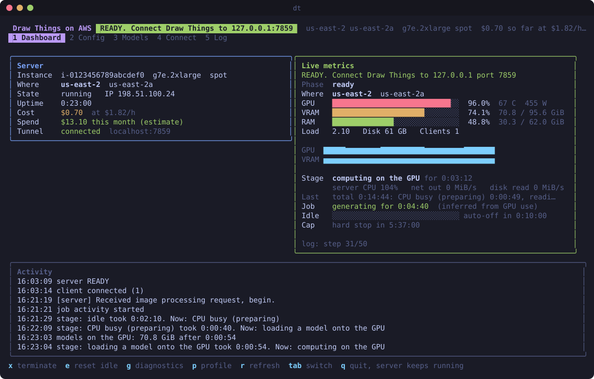
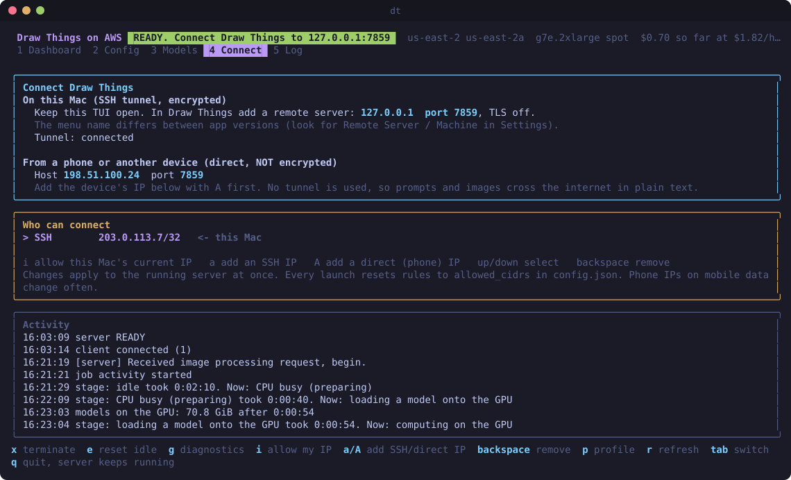
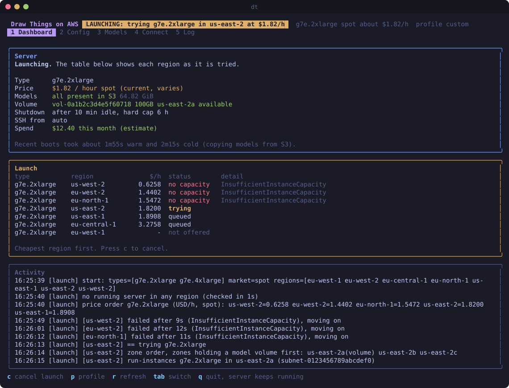
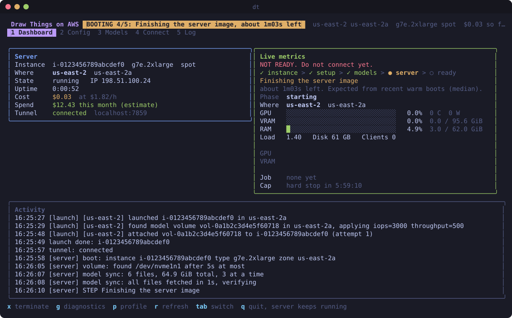
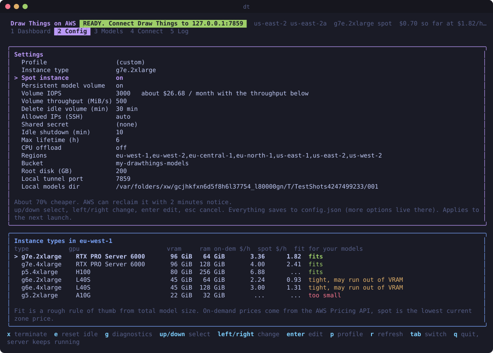
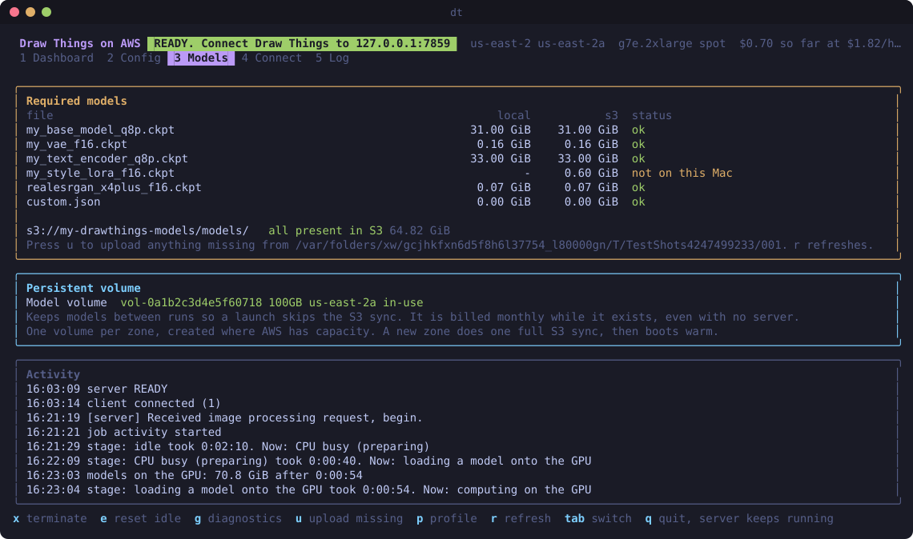
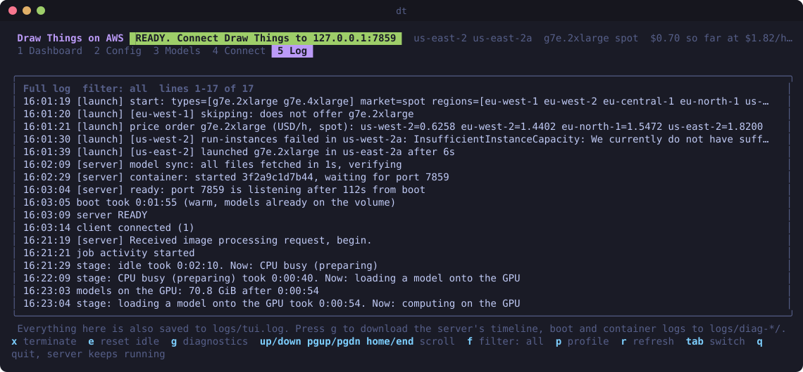
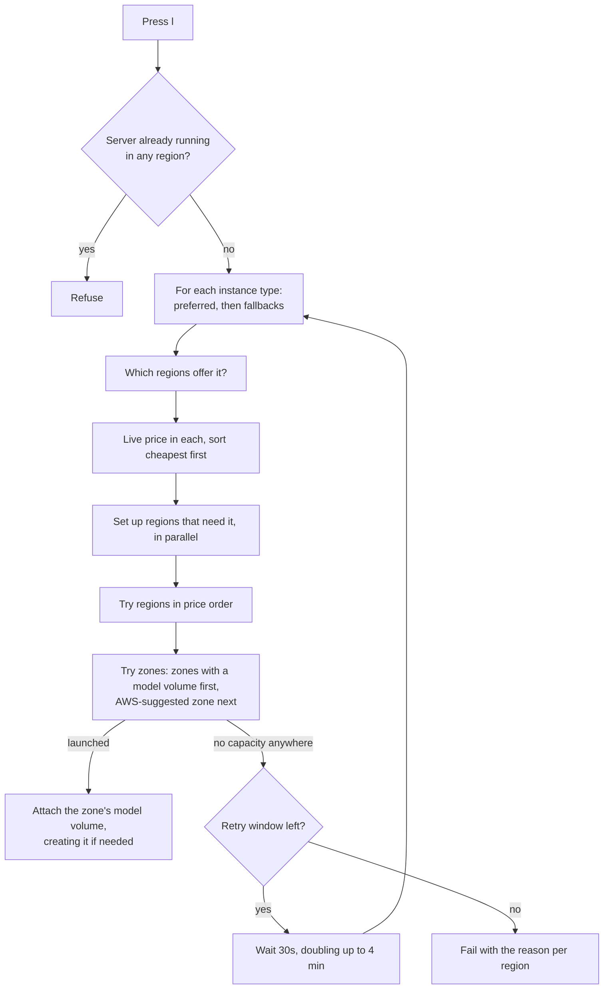

# drawthings-cloud

`dt` is a terminal app that rents a GPU server on AWS for the [Draw Things](https://drawthings.ai) app on your Mac.
It finds the cheapest region with spare capacity, boots a Draw Things gRPC server there, copies your models onto it,
and opens an encrypted SSH tunnel so Draw Things can use it as if it were local.
The server shuts itself down when it sits idle, so a forgotten session does not run up a bill.

It is one binary and one `config.json`. A setup wizard writes the config on first run. Everything else is created on demand.



## Contents

- [What it does](#what-it-does)
- [Requirements](#requirements)
- [Build and first run](#build-and-first-run)
- [Connecting Draw Things](#connecting-draw-things)
- [The screens](#the-screens)
- [Keys](#keys)
- [How a launch works](#how-a-launch-works)
- [How the server boots](#how-the-server-boots)
- [Staying cheap: shutdown rules](#staying-cheap-shutdown-rules)
- [The persistent model volume](#the-persistent-model-volume)
- [Costs](#costs)
- [Configuration reference](#configuration-reference)
- [Files it writes](#files-it-writes)
- [Logs and diagnostics](#logs-and-diagnostics)
- [AWS resources and permissions](#aws-resources-and-permissions)
- [Troubleshooting](#troubleshooting)
- [Development](#development)

See also [KNOWN_ISSUES.md](KNOWN_ISSUES.md) and [CHANGELOG.md](CHANGELOG.md).

This is an unofficial tool. It is not made by or affiliated with Draw Things. It is MIT licensed, see [LICENSE](LICENSE).

## What it does

- **Cheapest region first.** Each launch checks live spot or on-demand prices in every configured region and tries them cheapest first.
- **Capacity hunting.** GPU spot capacity is scarce. When a zone is full it tries the next zone, follows AWS's own "try this zone" hints, then the next region, then fallback instance types. It keeps retrying with backoff for a set time.
- **Fast warm boots.** Models live on a persistent EBS volume per zone. A warm boot skips the copy and is ready in about two minutes.
- **Safe by default.** Only SSH is open, and only from your IP. Draw Things talks to the server through an SSH tunnel on `127.0.0.1`.
- **Never forgotten.** The server terminates itself after a set idle time, after a hard maximum lifetime, or if it never becomes ready. A Lambda deletes the model volume after it sits unused.
- **Everything visible.** Live GPU, VRAM, RAM and disk metrics, a boot stepper with an ETA, a live launch table, job timing breakdowns, costs, and a full log of every step on both your Mac and the server.

## Requirements

| Need | Notes |
|---|---|
| macOS | Apple Silicon or Intel. Linux and Windows build but are not the target, see [KNOWN_ISSUES.md](KNOWN_ISSUES.md). |
| Go 1.26 or newer | Only to build. |
| An AWS account | Credentials in `~/.aws/credentials` or the usual `AWS_*` variables. `AWS_PROFILE` is honoured. |
| `ssh` and `ssh-keygen` | Built into macOS. |
| An S3 bucket | Holds your models under `models/`. `dt` can upload them for you. |
| Draw Things | On the Mac, iPhone or iPad that will connect. |

The `aws` CLI is **not** needed. `dt` talks to AWS through the AWS SDK for Go.

## Build and first run

```sh
go install github.com/conorarmstrong/drawthings-cloud@latest   # installs as drawthings-cloud
# or, from a clone:
go build -o dt .
./dt
```

With no `config.json`, `dt` starts a short setup wizard:

1. **S3 bucket.** The bucket that holds your models. Its region is looked up for you.
2. **Models folder.** Defaults to the Draw Things app folder on macOS.
3. **Models.** A list of the files in that folder. Tick the ones the server needs with space.
4. **Regions.** The regions you are happy to run in.
5. **Spot or on-demand.**
6. **Check and save.** Writes `config.json`. Everything else keeps its default and can be changed later on the Config tab.

`esc` goes back a step. The wizard then opens the Models tab:

1. Every file should say `ok`. Press `u` to upload anything missing.
2. Press `l` to launch. Watch the launch table.
3. When the headline turns green and says **READY**, connect Draw Things.

Prefer a file? Copy `config.example.json` to `config.json` and edit it, or run `./dt -init` to write one with the defaults.
`config.json` holds your own bucket and model names, so it is in `.gitignore`. `config.example.json` is the shared template.

The first launch in a region sets that region up. It creates the IAM role, a default VPC if there is none, a security group, the key pair and the volume reaper. This takes under a minute and only happens once per region.

You can quit `dt` with `q` at any time. The server keeps running and keeps its own shutdown rules. Start `dt` again to pick it back up.

## Connecting Draw Things



**From the Mac running `dt` (recommended).**
Keep `dt` open. In Draw Things add a remote server at `127.0.0.1`, port `7859` (`local_port`), TLS off.
Traffic goes through the SSH tunnel, so it is encrypted.

**From a phone or another device.**
Press `A` on the Connect tab and add the device's IP. It can then reach the server's public IP on `server_port` directly.
This path is **not encrypted**, so prompts and images cross the internet in plain text.
Set a `shared_secret` so the server asks for a password.

Every launch resets the firewall to `allowed_cidrs`. Rules added with `i`, `a` or `A` last until the next launch.

## The screens

The top line always shows what is happening and what to do next, plus where the server is and what it has cost so far.
The bottom line lists only the keys that work right now.

### 1 Dashboard

While launching, the dashboard shows the live launch table. Each row is an instance type in a region, with its current price and what happened.



While booting, the metrics panel shows a stepper (instance, setup, models, server, ready) and the expected time left.
The estimate is the median of your recent boots of the same kind, warm or cold. It appears after the first measured boot.



Once ready, the dashboard shows:

- **Server:** instance, region and zone, uptime, cost so far, month spend, tunnel state.
- **Live metrics:** GPU use, temperature and power, VRAM, RAM, load, sparklines, clients connected.
- **Stage:** what the server is doing now, inferred from the numbers. It is one of: CPU busy preparing, reading the model disk, loading a model onto the GPU, computing on the GPU, sending data to your Mac, or idle.
- **Last:** the time breakdown of the last job.
- **Job, Idle, Cap:** current generation time, time until idle shutdown, time until the hard stop.
- **Activity:** the newest log lines.

### 2 Config



The common settings, editable in place. Everything saves to `config.json` and applies to the next launch.
Below them is a table of the candidate instance types in the current region, with GPU, VRAM, RAM, on-demand and spot prices,
and a rough fit check against the total size of your models.

### 3 Models



Each required model with its size on your Mac and in S3. `u` uploads anything missing or a different size.
Below is the persistent model volume, one per zone, with `d` to delete unused ones.

### 4 Connect

Shows how to connect and who may connect. See [Connecting Draw Things](#connecting-draw-things).

### 5 Log



Every line from this Mac and from the server, newest at the bottom. Scroll with the arrow keys, page up and down, and home and end.
`f` cycles the filter: all, this Mac, server, problems.
The same lines are appended to `logs/tui.log`.

## Keys

Keys only appear in the bottom bar when they do something.

| Key | Where | Does |
|---|---|---|
| `l` | no server | Launch. |
| `l` `l` | server shutting down | Force-detach the model volume from the old server and launch a new one now. |
| `c` | launching | Cancel the launch at the next step. |
| `x` `x` | server running | Save diagnostics, unmount and detach the model volume, terminate. |
| `d` `d` | server shutting down | Force-detach the model volume only. |
| `d` `d` | Models tab | Delete model volumes that no server uses. |
| `e` | server ready | Reset the idle timer. |
| `g` | server running | Save the server's logs to `logs/diag-<time>/`. |
| `u` | Models tab | Upload missing models to S3. |
| `i` | anywhere | Allow this Mac's current IP to SSH. |
| `a` / `A` | anywhere | Add an SSH IP / a direct (phone) IP. |
| `backspace` | Connect tab | Remove the selected rule. |
| `f` | Log tab | Cycle the log filter. |
| arrows, `pgup`, `pgdn`, `home`, `end` | Log tab | Scroll. |
| arrows, `enter`, `esc` | Config tab | Select, change, edit, cancel. |
| `p` | anywhere | Cycle profiles. |
| `r` | anywhere | Refresh everything from AWS. |
| `1` to `5`, `tab` | anywhere | Switch tabs. |
| `q` | anywhere | Quit. The server keeps running. |

A key pressed twice asks for confirmation in a red line above the key bar. Any other key cancels.

## How a launch works



Details:

- **Price source.** Spot uses the lowest current zone price from the spot price history. On-demand uses the AWS Pricing API, which needs the region in `pricing_locations`.
- **One attempt per zone.** `run-instances` is called with SDK retries off, so a full zone fails in about a second instead of twenty.
- **Zone hints.** When AWS replies "...or choosing us-east-1b", that zone is tried next.
- **Fallback types.** `fallback_instance_types` are tried, in order, only after the main type fails everywhere.
- **Retry window.** `launch_retry_minutes` (default 10) bounds the whole launch. Waits start at 30 seconds and double up to 4 minutes.
- **Firewall.** Port 22 is set to exactly `allowed_cidrs`, where `auto` means your current public IP. The server port is closed, because the tunnel is used.
- **Dry run.** `./dt -dry-launch` runs the whole path, but EC2 only validates the request. Nothing is started or changed. It checks permissions, the AMI, key, security group, IAM profile and boot script. It does not check capacity.

## How the server boots

The boot script is `assets/userdata.sh`. It is built into `dt` and filled in from `config.json` at launch.

1. **Instance.** Ubuntu with the NVIDIA driver, from the AWS Deep Learning base AMI (`ami_ssm_parameter`). Root disk is gp3, 16000 IOPS, 1000 MiB/s.
2. **Setup.** Starts the watchdog, the metrics feed and the timeline logger. Uses IMDSv2 only.
3. **Volume.** Waits for the model volume, formats it on first use, and mounts it at `/opt/models`.
4. **Models.** Copies the model files from S3, three at a time. Files already on the volume are skipped, so a warm boot takes about a second here.
5. **Server image.** Runs in parallel with the model copy. With `image_cache` on, it loads a compressed copy of the Docker image from your bucket when it matches Docker Hub, otherwise it pulls from Docker Hub and saves a copy for next time.
6. **Server.** Starts `drawthingsai/draw-things-grpc-server-cli` with your models, waits for the port, and reports **ready**.

Everything the server does is written to `/var/log/dt-events.log` and streamed live into the TUI log.

## Staying cheap: shutdown rules

The server shuts itself down, which terminates it, when any of these happen:

| Rule | Setting | Default |
|---|---|---|
| Idle: no GPU use, no VRAM change, no model disk reads | `idle_minutes` | 10 |
| Hard maximum lifetime | `max_hours` | 6 |
| Never became ready | `boot_timeout_minutes` | 60 |
| Spot interruption | AWS | 2 minutes notice, shown in red |

"Busy" is `gpu_idle_percent` (default 5) or more GPU use in a 30-second window, VRAM changing by more than 200 MiB, or more than 30 MiB read from the model disk.
Press `e` to reset the idle timer by hand.

`dt` also warns after `warn_after_hours` and when `monthly_budget_usd` is reached, with a macOS notification.

## The persistent model volume

With `model_volume.enabled` on, models are kept on a gp3 EBS volume so the next boot skips the copy.

- **One volume per zone.** A volume can only attach to a server in its own zone. Zones that already hold one are tried first. A new zone does one full copy, then boots warm.
- **Created after launch.** A volume is only created once an instance has started in that zone, so a failed zone never leaves a volume behind.
- **Speed.** `iops` and `throughput_mibs` are applied at every launch. AWS allows one change per volume every six hours.
- **Reaper.** A small Lambda in each region runs every five minutes. It deletes a volume that has been unattached for `delete_after_minutes` (default 30). Set it to 0 to keep volumes forever.
- **Cost.** A volume is billed every month while it exists, even with no server. The Config tab shows the monthly estimate.
- **Clean release.** Terminating with `x` stops the container, unmounts and detaches the volume first, so a relaunch can use it at once. If the old server is stuck shutting down, `l l` or `d d` force-detaches it.

## Costs

| Item | When | Rough figure |
|---|---|---|
| GPU instance | while it runs | `g7e.2xlarge` spot was $0.63 to $3.28/h across regions on 2026-11-18, on-demand $3.36/h in us-east-2. |
| Root disk | while it runs | 200 GB gp3 with high IOPS. Small next to the instance. |
| Model volume | every month while it exists | 100 GB, 3000 IOPS, 500 MiB/s is about $26.68/month at London prices. |
| S3 storage | always | Your models, plus the cached server image. |
| S3 transfer | each cold boot outside the bucket's region | Cross-region transfer is charged per GB. |
| Lambda and EventBridge | always | Negligible. |

The dashboard shows the session cost so far and the month's estimated spend. Session costs are price at the last poll times hours, recorded in `.state/history.jsonl`. They are estimates, not your AWS bill.

## Configuration reference

`config.json` is written by the setup wizard, or by `./dt -init`, and rewritten when you change settings in the TUI.
`config.example.json` shows every key with example values. `~` at the start of `local_models_dir` and `ssh_key_file` means your home folder.

| Key | Default | Meaning |
|---|---|---|
| `regions` | eu-west-1, eu-west-2, eu-central-1, eu-north-1, us-east-1, us-east-2, us-west-2 | Regions to launch in, tried cheapest first. With no server running, the Config tab shows the region last launched in, else the first. |
| `region` | first of `regions` | Kept in sync with `regions[0]`. |
| `bucket` | | S3 bucket holding `models/`. Asked for by the wizard. |
| `bucket_region` | | The bucket's region. Looked up by the wizard. |
| `instance_type` | g7e.2xlarge | Preferred instance type. |
| `fallback_instance_types` | g7e.4xlarge | Tried in order after the preferred type fails everywhere. |
| `candidate_instance_types` | g7e.2xlarge, g7e.4xlarge, p5.4xlarge, g6e.2xlarge, g6e.4xlarge, g5.2xlarge | Shown on the Config tab. |
| `spot` | true | Spot or on-demand. |
| `launch_retry_minutes` | 10 | How long a launch keeps retrying. |
| `idle_minutes` | 10 | Idle shutdown. |
| `max_hours` | 6 | Hard maximum lifetime. |
| `boot_timeout_minutes` | 60 | Shut down if not ready by then. |
| `gpu_idle_percent` | 5 | GPU use at or above this counts as busy. |
| `volume_gb` | 200 | Root disk size. |
| `cpu_offload` | false | Passes `--cpu-offload` to the server. |
| `allowed_cidrs` | auto | Who may SSH. `auto` is your current public IP, looked up at every launch. |
| `shared_secret` | empty | Optional password the server asks Draw Things for. |
| `model_volume.enabled` | true | Use a persistent model volume. |
| `model_volume.name` | drawthings-models | Volume Name tag. |
| `model_volume.size_gb` | 100 | Volume size. |
| `model_volume.iops` | 3000 | gp3 IOPS, 3000 to 16000. |
| `model_volume.throughput_mibs` | 500 | gp3 throughput, 125 to 1000, at most IOPS/4. |
| `model_volume.delete_after_minutes` | 30 | Reaper delay. 0 keeps volumes. |
| `local_port` | 7859 | Tunnel port on this Mac. |
| `server_port` | 7859 | Port the server listens on. |
| `local_models_dir` | the Draw Things app folder | Where your models live on this Mac. |
| `models` | | Files the server needs. Picked in the wizard. |
| `key_name` | drawthings | EC2 key pair name. |
| `ssh_key_file` | ~/.ssh/drawthings_aws | Private key. Created with `ssh-keygen` if missing. |
| `ssh_user` | ubuntu | Server login. |
| `role_name` | drawthings-server | IAM role and instance profile for the server. |
| `sg_name` | drawthings-ssh | Security group name. |
| `project_tag` | drawthings | `Project` tag on everything `dt` creates. |
| `docker_image` | drawthingsai/draw-things-grpc-server-cli:latest | Server image. |
| `image_cache` | true | Cache the server image in S3. See [KNOWN_ISSUES.md](KNOWN_ISSUES.md). |
| `ami_ssm_parameter` | Deep Learning base OSS NVIDIA driver, Ubuntu 22.04 | SSM parameter that names the AMI. |
| `pricing_locations` | 8 regions | Region code to Pricing API location name, for on-demand prices. |
| `warn_after_hours` | 3 | Warn when a server has been up this long. |
| `monthly_budget_usd` | 0 | Warn at this month spend. 0 is off. |
| `notifications` | true | macOS notifications. |
| `profile`, `profiles` | cheap, safe | Presets that override type, spot, idle, max hours and CPU offload. `p` cycles them. |

## Files it writes

| Path | What |
|---|---|
| `config.json` | Your settings. Not tracked by git. |
| `.state/sg_id.<region>` | Security group of each set-up region. Delete it if you delete the group in the console. |
| `.state/last_region` | Region of the last launch, used for browsing. |
| `.state/history.jsonl` | One line per finished session with its estimated cost. |
| `.state/boots.jsonl` | One line per measured boot, for the boot ETA. |
| `.state/gpu_load_mib` | VRAM used by the last full model load, for the load progress bar. |
| `.state/userdata.sh` | The filled-in boot script of the last launch. |
| `logs/tui.log` | Every log line, with dates. |
| `logs/diag-<time>/` | Server logs saved by `g` or before a terminate. |

## Logs and diagnostics

- **Live:** the Log tab, and `logs/tui.log`.
- **On the server:** `/var/log/dt-events.log` (events), `/var/log/drawthings-boot.log` (boot script), `/var/log/dt-image.log` (image fetch), `/var/log/dt-timeline.log` (CSV every 2 seconds), `/var/log/dt-server-events.log` (server log lines).
- **Saved:** `g` copies all of these, the container log and a system summary to `logs/diag-<time>/`. `x` does the same before terminating.
- **By hand:** `ssh -i ~/.ssh/drawthings_aws ubuntu@<server ip>`.

## AWS resources and permissions

`dt` creates and tags with `Project=<project_tag>`:

- **Per account:** IAM role and instance profile `role_name`, which can read `models/` and read and write `image/` in your bucket. IAM role `<role_name>-reaper` for the Lambda.
- **Per region:** a default VPC if missing, security group `sg_name`, key pair `key_name`, Lambda `<project_tag>-volume-reaper` and its EventBridge schedule.
- **Per launch:** the instance and its root disk, and a model volume per zone.

The AWS identity running `dt` needs to:

- **EC2:** describe, run and terminate instances; create, modify, attach, detach and delete volumes; manage security groups, key pairs and the default VPC; read spot price history.
- **IAM:** get, create and update the two roles and the instance profile, and `iam:PassRole` for them.
- **Other services:** create and update the Lambda function and its EventBridge rule; read SSM parameters; read the Pricing API; call STS get-caller-identity; read and write S3 for uploads.

## Troubleshooting

| Symptom | Cause and fix |
|---|---|
| Launch fails with `InsufficientInstanceCapacity` everywhere | No spot capacity right now. Wait, add regions, add fallback types, or turn spot off. |
| A region always says "does not offer" | That type is not sold there. It is skipped automatically. |
| A region always fails with `InvalidGroup.NotFound` | The security group was deleted. Delete `.state/sg_id.<region>` and launch again. |
| "Waiting for SSH and the metrics stream" for a long time | Your IP changed. Press `i`, or check the Connect tab. |
| No on-demand price shown | Add the region to `pricing_locations`. |
| Server is stuck shutting down and holds the volume | `l l` relaunches now, `d d` only frees the volume. |
| Session cost recorded as $0 | No price was known when the server ended. The log says so. |
| Boot ETA missing | It needs one measured boot of that kind first. |

## Development

```sh
go vet ./...
go test ./...                                   # unit tests, no AWS calls
DT_LIVE=1 go test -run 'TestLive' -v ./...      # read-only AWS checks, plus one rule add and remove
./dt -dry-launch                                 # whole launch path, nothing started
```

| File | What |
|---|---|
| `main.go` | Bubble Tea model, messages, keys, metrics tracking. |
| `views.go`, `chrome.go`, `ui.go` | Screens, headline, key bar, launch table, stepper, styles. |
| `launch.go` | Launch, region setup, IAM, reaper, volume attach. |
| `ops.go` | Terminate, detach, delete volumes, diagnostics, upload. |
| `aws.go`, `cloud.go` | AWS SDK clients and read-only lookups. |
| `boot.go` | Boot timing and ETA. |
| `config.go` | Config and defaults. |
| `history.go` | Session costs and notifications. |
| `assets/userdata.sh` | Server boot script, embedded. |
| `assets/reaper.py` | Volume reaper Lambda, embedded. |
| `docs/screenshots/` | Screenshots in this README, rendered from the real views with demo data. |
